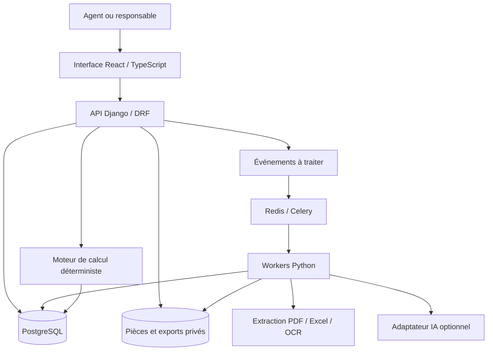

# ClairTransit — Conception technique détaillée

Version 1.0 — 6 octobre 2026. À lire avec le cahier des charges et la matrice de recette. Les choix ci-dessous sont proposés pour la V1 ; les versions exactes des dépendances seront vérifiées et verrouillées lors de l’initialisation.

## 1. Architecture retenue

Une application modulaire comprenant une interface web React/TypeScript, une API Django/Django REST Framework, PostgreSQL, un stockage de documents privé compatible S3 et des workers Celery avec Redis comme courtier. Le métier reste dans des services Python partagés par l’API et les workers. Les calculs ne sont exécutés que côté serveur.



Modules Django proposés : `accounts`, `organizations`, `clients`, `cases`, `documents`, `extraction`, `tariffs`, `classification`, `valuation`, `taxation`, `workflow`, `exports`, `audit`. Une organisation de dossiers ne doit pas créer des dépendances circulaires : les services métier utilisent des interfaces explicites, les modèles partagés restent petits.

Le client web et l’API peuvent être servis sous le même domaine, avec `/api/v1/` pour l’API. Authentification de navigateur proposée : session serveur, cookie HttpOnly/Secure et protection CSRF. Ne pas stocker de jeton durable dans le stockage local du navigateur. Prévoir un mécanisme d’authentification spécifique si une API tierce est ajoutée ultérieurement.

PostgreSQL constitue la source de vérité. Redis ne détient aucune information métier irremplaçable. Le stockage objet contient les octets des fichiers ; la base conserve identité, version, empreinte, droits et liens.

## 2. Choix et raisons

| Besoin | Choix | Justification / limite |
|---|---|---|
| Interface de correction riche | React + TypeScript | Composants de tableau, formulaires et document côte à côte ; logique métier autoritaire côté serveur |
| API, utilisateurs et administration | Django + DRF | Authentification, modèles relationnels, migrations et administration du référentiel |
| Données et recherche initiale | PostgreSQL, recherche textuelle et pg_trgm | Volume tarifaire limité ; recherche exacte/préfixe/texte sans service supplémentaire |
| Lecture Excel | openpyxl | Lire séparément formule et valeur en cache ; aucune exécution de formule externe |
| Lecture PDF texte/tableaux | pdfplumber | Coordonnées, texte et tableaux ; les résultats restent à contrôler |
| Scans | Adaptateur OCR, premier essai Tesseract | Mesurer sur factures réelles ; alternative remplaçable si qualité insuffisante |
| Documents | Stockage compatible S3 | Accès privé, sauvegarde et conservation des versions |
| Travaux longs | Celery + Redis | Extraction, OCR et exports en arrière-plan |
| Calcul | Services Python et Decimal | Assiettes, arrondis et résultats reproductibles |
| Déploiement | Docker, serveur Linux | Environnement reproductible ; PostgreSQL géré possible selon hébergement |

La bibliothèque de visualisation PDF côté client sera choisie et sa licence vérifiée lors du lot documentaire. La première extraction validée sur le tarif ne garantit pas la qualité sur les factures ; un corpus d’essai est obligatoire. La recherche sémantique, si ajoutée, sera évaluée contre la recherche existante et ne remplacera pas les contrôles d’édition et de règles.

Références techniques consultées : [Django](https://docs.djangoproject.com/en/5.2/), [DRF](https://www.django-rest-framework.org/), [React](https://react.dev/), [PostgreSQL pg_trgm](https://www.postgresql.org/docs/17/pgtrgm.html), [Celery](https://docs.celeryq.dev/en/stable/getting-started/introduction.html), [pdfplumber](https://github.com/jsvine/pdfplumber). Ces liens étayent les capacités, pas un choix définitif de versions.

## 3. Principes de données

- UUID pour identifiants techniques, références lisibles propres aux sociétés.
- Code douanier et référence fournisseur stockés en texte ; jamais en entier.
- Longueur de code configurée par édition/niveau ; ne pas imposer huit chiffres à tout le système.
- Horodatages UTC en base, affichage selon fuseau de la société. Dates d’effet juridiques distinctes des dates d’import.
- Montants, taux, quantités et conversions en Decimal. Proposition : NUMERIC(24,8) pour les entrées/intermédiaires, taux de change NUMERIC(28,12). Vérifier les limites et éviter toute perte implicite au stockage ; arrondis métier configurés séparément.
- JSON pour attributs extensibles et instantanés, avec schéma validé et numéro de version. Les relations clés restent des clés étrangères.
- Codes normalisés par retrait de séparateurs autorisés et conservation des zéros ; aucune réparation de chiffre par simple supposition.
- Source brute, extraction, correction et décision sont des objets distincts.
- Publication immuable : modifier une règle publiée crée une nouvelle version ; enregistrer date d’effet et date de publication.

Ne pas confondre trois axes : qualité de donnée (`known`, `unknown`, `conflict`), traitement fiscal (`taxable`, `exempt`, `not_applicable`) et état de validation (`extracted`, `review_required`, `validated`). Le caractère historique appartient à l’édition/usage ; il ne remplace pas l’état de qualité. Un taux connu nul a un montant Decimal zéro et reste distinct d’une absence de taux.

## 4. Modèle relationnel

Notation : `?` = nullable, `FK` = relation, `JSON` = structure validée. Tous les objets métier portent `created_at`, et les objets mutables `updated_at` et `row_version`. Les objets propres à une société portent `organization_id` obligatoire, y compris les tables enfants lorsque nécessaire à l’isolation.

### Identités et dossiers

| Entité | Champs principaux | Contraintes |
|---|---|---|
| Organization | id, name, timezone, validation_policy, active | Politique versionnée pour les décisions |
| User | id, email, active | Identité globale ; droits via Membership |
| Membership | organization FK, user FK, roles | Unicité organisation/utilisateur |
| Importer | id, organization FK, name, identifiers JSON, contacts JSON | Doublons signalés, pas fusion automatique |
| CustomsCase | id, organization FK, reference, importer FK, assigned_to FK, current_revision FK, archived_at? | Référence unique par organisation |
| CaseRevision | id, case FK, revision_no, parent_revision?, state, territory, planned_declaration_date?, regime?, mode, row_version | Unicité dossier/révision ; mode demo/historical/operational |
| Invoice | id, revision FK, supplier, invoice_number?, invoice_date?, currency?, declared_total?, document FK | Facture logique rattachée à sa preuve |
| InvoiceLine | id, invoice FK, ordinal, source_reference?, description_raw, quantity?, unit?, unit_price?, amount?, origin? | Ligne facturée d’origine ; corrections révisées |
| GoodsLine | id, revision FK, ordinal, description, attributes JSON, origin?, regime?, valuation_status | Marchandise à préparer, distincte de la ligne facturée |
| GoodsLineSource | goods_line FK, invoice_line FK, assigned_quantity?, assigned_value? | Traçabilité des divisions/regroupements ; conservation des totaux |

Un dossier peut contenir plusieurs origines ou devises ; les champs du dossier sont des valeurs proposées, jamais un écrasement silencieux des champs de ligne.

### Documents et extractions

| Entité | Champs principaux | Contraintes |
|---|---|---|
| Document | id, organization FK, object_key, original_name, mime, bytes, sha256, kind, version, supersedes?, uploaded_by | Original immuable ; clé de stockage non devinable |
| CaseDocument | revision FK, document FK, usage | Autorisation dérivée de la société et du dossier |
| ExtractionRun | document FK, parser_version, provider?, model?, schema_version, status, attempt, output_key?, error_code? | Nouvelle tentative conserve l’ancienne |
| FieldObservation | run FK, entity_ref, field_name, raw_value, parsed_value JSON, origin_type, confidence?, source_span FK | Une inférence doit être étiquetée ; score nullable |
| SourceSpan | document FK, page_index?, printed_page?, bbox?, sheet?, cell_range?, excerpt? | Une localisation vérifiable ; convention de coordonnées documentée |
| FieldCorrection | entity_ref, field_name, previous, current, actor, reason, source_span? | Append-only ; correction séparée de l’extraction |
| BackgroundJob | id, organization?, kind, state, progress, attempts, input_hash, result_ref?, error_code? | Pas de validation métier implicite à la fin |

Pour bbox : page physique indexée à partir de 1 dans l’API, coordonnées normalisées 0–1 depuis le coin supérieur gauche de la page rendue, rotation et dimensions conservées. Pour Excel : feuille et plage A1 ; pas de page inventée.

### Référentiel

| Entité | Champs principaux | Contraintes |
|---|---|---|
| SourceDocument | document FK, publisher_claimed, title, edition_label, source_url?, retrieved_at?, sha256 | Provenance déclarée et vérifiée distinguées |
| TariffEdition | id, label, hs_version?, territory_scope, effective_from?, effective_to?, applicability_verified, publication_state | Dates inconnues interdisent la sélection opérationnelle automatique |
| RawTariffRecord | import_run FK, source_span FK, raw_cells JSON, formula?, cached_value? | Accepte erreurs/doublons ; aucune déduplication destructive |
| TariffNode | id, edition FK, code?, kind, parent FK?, display_order, label_raw, label_clean, full_path_label, declarable, validation_state | Les intertitres peuvent ne pas avoir de code ; unicité des codes validés dans une édition selon niveau |
| LegalNote | id, edition FK, scope_type, scope_ref, number?, text_raw, text_clean, source_span FK | Renvois conservés et résolus séparément |
| NoteLink | note FK, target_node?, target_note?, relation_type | Inclusion, exclusion, définition, priorité, renvoi |
| QuantityRequirement | node/scope, unit, conditions JSON, exclusions JSON, source_span FK, version | L’unité ne découle pas d’une simple proximité de texte |
| CodeMapping | source_edition, source_code, target_edition, target_code, relation, conditions, evidence, validation_state | Plusieurs relations possibles ; aucune migration implicite |
| ImportIssue | import_run FK, record FK?, category, severity, details, resolution?, resolved_by? | Ligne litigieuse visible et non publiée avant résolution |
| ImportRun | source FK, importer_version, started_at, status, counts JSON, coverage JSON | Relance identifiable ; publication séparée |

### Contrôle des codes et décisions

| Entité | Champs principaux | Contraintes |
|---|---|---|
| CodeObservation | invoice_line FK, field_label, raw_code, normalized_code?, code_kind, claimed_scheme?, source_span FK | code_kind : customs/supplier/ambiguous |
| CodeCheck | goods_line FK, observation FK?, target_edition FK, state, findings JSON, checked_input_hash | États missing/ambiguous/incomplete/not_found/edition_mismatch/inconsistent/recognized |
| ClassificationProposal | goods_line FK, node FK, reasons, note_refs, missing_attributes, retrieval_score?, producer | Seulement si assistance nécessaire ou explicitement demandée |
| ClassificationDecision | goods_line FK, original_observation?, selected_node FK, action, reason, actor, evidence_refs, timestamp | action confirm/complete/replace/classify ; confirmation traçable |

Un `recognized` signifie « retrouvé dans le référentiel », pas « approuvé ». La décision humaine peut confirmer un code reconnu. Une proposition doit référencer un nœud existant autorisé dans la version sélectionnée ; un code inventé par l’IA est rejeté.

### Valorisation, fiscalité et exports

| Entité | Champs principaux | Contraintes |
|---|---|---|
| Valuation | goods_line FK, method, currency, invoice_value, adjustments JSON, customs_value?, evidence_refs | Versionné ; valeurs vérifiées avant calcul opérationnel |
| ExchangeRate | currency_from/to, value, effective_date, authority_source, validation_state | Direction explicite ; aucune inversion implicite |
| Charge | revision FK, type, amount, currency, included_status, evidence | included/excluded/unknown distincts |
| ChargeAllocation | charge FK, goods_line FK, method, weight, exact_share, rounded_share, residual_adjustment | Somme des parts = montant à répartir |
| TaxProfileVersion | territory, effective_from/to, regime_scope, published_at, state, source_refs, expected_tax_types | Snapshot immuable ; couverture explicite |
| TaxRuleVersion | profile FK, tax_type, scope, condition_tree, base_expression, rate_kind, rate_value?, rate_category?, unit?, rounding_policy, evidence_refs | Ad_valorem/specific/fixed/exempt ; DAG d’assiettes sans cycle |
| ExemptionClaim | revision/line FK, rule FK, evidence, beneficiary, validity, decision | Aucun taux zéro implicite en attente de preuve |
| CalculationRun | revision FK, input_hash, profile_version FK, engine_version, input_snapshot, status, total?, errors, created_by | complete/incomplete/conflict ; total null si incomplet |
| TaxResult | run FK, line FK, tax_type, base, rate?, amount?, status, rule_ref, explanation | Résultats partiels étiquetés |
| Approval | revision FK, input_hash, calculation_run FK, actor, decision, reason, timestamp | Approbation lie exactement les données approuvées |
| ExportArtifact | revision FK, approval?, run FK?, format, template_version, sha256, document FK, mode | Export immuable et reproductible à données/version identiques |
| AuditEvent | organization?, actor, event_type, entity_ref, previous/current?, request_id, at | Append-only ; contenu sensible limité |

## 5. Isolation et invariants de base

Toutes les requêtes métier sont bornées à la société active dérivée de la session et de Membership. Un `organization_id` fourni par le client ne confère aucun droit. Les services vérifient aussi que les FK appartiennent à la même société ; aucune liaison à une facture d’un autre locataire n’est permise. Tester les endpoints de détail, listes, recherche, téléchargements et workers.

Les workers rechargent leur contexte autorisé depuis des identifiants validés. Les permissions sont revérifiées pour toute publication de résultat sensible. Un lien de téléchargement est temporaire, généré après contrôle ; le stockage n’est pas public. Des politiques PostgreSQL RLS peuvent renforcer la défense si leur mise en œuvre et le contexte des workers sont testés ; elles ne remplacent pas les contrôles applicatifs.

Une révision validée et ses instantanés sont immuables. Les modifications ordinaires portent sur une nouvelle révision. Les suppressions physiques de pièces liées à une décision sont exclues du parcours courant ; la politique de conservation/droits d’effacement sera traitée par procédure dédiée.

## 6. Ingestion du référentiel

1. Enregistrer fichier, empreinte et métadonnées sans modifier l’original.
2. Extraire une zone brute conservant page/cellule, ordre, coordonnées, texte et valeurs.
3. Pour Excel, lire formules et caches séparément. Aucun accès au classeur externe manquant.
4. Pour PDF, détecter titres, codes et colonnes avec coordonnées ; garder les retraits et les continuations entre pages. Le code et le taux ne doivent pas être associés uniquement parce qu’ils partagent une ligne de texte extrait.
5. Produire des candidats de nœuds, notes, liens et observations fiscales.
6. Vérifier format, parents, doublons, chapitres, plages et taux ; rapport de couverture avec pages sans extraction et raisons.
7. Présenter les anomalies à un gestionnaire, avec ouverture de la page/cellule.
8. Publier une édition consultable après contrôles. La publication pour calcul opérationnel exige un profil fiscal distinct validé et daté.

Conserver les taux historiques comme observations avec source. Ne pas convertir DSO/STT/TPM/OAD en règles fiscales dont la signification n’est pas établie. Ne pas appliquer une stratégie « PDF gagne toujours » ou « fichier le plus récent gagne » : les contradictions deviennent des anomalies à résoudre.

Les constats déjà vérifiés sont décrits dans `../audit-et-conception.md` ; ce dossier est une référence d’audit, pas un jeu de règles fiscales prêt à exécuter.

## 7. Pipeline des factures

Réception → contrôle de format/taille → stockage privé → extraction native → OCR des pages nécessaires → structuration → contrôles arithmétiques → observations → revue humaine.

Un adaptateur retourne un schéma commun : facture, lignes, observations de code, localisation, valeurs absentes et avertissements. Les nombres lus avec virgule/point sont normalisés selon le contexte du document ; une ambiguïté de séparateur doit être signalée. Le total imprimé et le total recalculé sont deux champs distincts.

Extraction des codes : chercher le titre de colonne et le contexte, pas seulement une chaîne de chiffres. Capturer `field_label`, `code_kind`, `raw_code`, `normalized_code`, `claimed_scheme` et la preuve. Une référence numérique de huit chiffres n’est pas automatiquement un code douanier.

La fusion avec les données utilisateur conserve les corrections humaines. Si une nouvelle extraction contredit une correction, créer une divergence à examiner. Les tâches sont idempotentes sur document + version de parseur + options ; une nouvelle version crée une nouvelle exécution.

## 8. Algorithme de contrôle et recherche

```text
si aucun code douanier observé : état missing, proposer recherche
sinon si nature du champ ambiguë : état ambiguous, demander confirmation
sinon normaliser les séparateurs autorisés et identifier l’édition annoncée
résoudre l’édition cible pour la consultation ou le dossier
si édition cible opérationnelle inconnue : blocage d’applicabilité
si code trouvé mais non déclarable : état incomplete, afficher subdivisions
si code non trouvé : état not_found ou edition_mismatch selon preuves
si contradiction connue avec caractéristiques : état inconsistent
sinon : état recognized, afficher source et demander confirmation métier
```

`recognized` n’atteste pas que toutes les exclusions ont été vérifiées. Montrer les caractéristiques importantes manquantes selon la famille. Les notes sont consultables dans tous les cas.

Recherche : filtre d’édition/territoire/état → correspondance exacte → préfixe → texte intégral français + synonymes approuvés → trigrammes. Indexer libellé propre, chemin des parents et attributs documentés ; les références de notes restent rattachées aux nœuds. Limiter les candidats et expliquer la raison de leur présence.

Un modèle d’IA peut reformuler une requête ou expliquer les différences entre candidats fournis. Ses sorties sont validées par schéma ; codes et références doivent exister dans les données fournies. Si les preuves sont insuffisantes, retourner des questions ou aucune proposition. Conserver version du prompt/modèle et références utilisées, sans exposer de raisonnement interne opaque comme preuve juridique.

L’automatisation de toutes les notes de tous les chapitres n’est pas un prérequis V1. La V1 fournit les notes, applique les règles explicitement encodées et indique la couverture des contrôles. Les règles supplémentaires sont ajoutées avec exemples et tests métier.

## 9. Moteur de calcul

### Entrées et sélection des règles

Entrées immuables : lignes, codes décidés, version tarifaire, territoire, date, origine/régime, méthode de valorisation, composantes, change, quantités complémentaires, exemptions et profil fiscal. La date prévue est clairement indiquée ; changer la date impose une nouvelle résolution des règles.

Les intervalles de validité sont définis `[effective_from, effective_to)` ; aucune fin signifie ouvert, à condition que le début et l’applicabilité soient validés. Une absence de date vérifiée n’est pas assimilée à « toujours applicable ».

Le profil énumère les taxes attendues et leurs conditions : absence d’une règle ne signifie pas absence de taxe. Deux règles concurrentes non départagées provoquent un conflit, pas un choix arbitraire. Les dérogations ont une priorité explicite et une source ; une règle nationale peut compléter une règle régionale selon un lien documenté.

### Exécution

1. Valider schéma, unités, preuves, complétude et version des données.
2. Convertir les composantes monétaires avec direction et source du change.
3. Répartir les frais documentés, déduire les composantes déjà incluses selon les règles validées.
4. Déterminer valeur en douane selon méthode prise en charge ; sinon exiger une valeur validée et justifiée.
5. Sélectionner les règles, construire leur graphe de dépendances et rejeter un cycle.
6. Évaluer les conditions en logique vrai/faux/inconnu. Inconnu sur une condition nécessaire bloque la taxe concernée et ses dépendantes.
7. Calculer chaque taxe avec Decimal, règle d’arrondi et source.
8. Produire les résultats partiels éventuels, puis un total uniquement si complet.
9. Enregistrer entrées, versions, résultats, erreurs et empreinte.

Arbre de règles limité : opérateurs logiques autorisés, comparaisons de champs typés, addition, soustraction, multiplication, division contrôlée, minimum/maximum si nécessaires. Interdire `eval`, code arbitraire, accès réseau et accès au système de fichiers dans les règles fiscales.

Chaque profil indique étape d’arrondi, précision, mode et traitement des reliquats. Aucun choix d’arrondi technique ne devient une règle douanière par défaut.

### Exemple purement synthétique de recette

Profil `TEST_ONLY`, sans validité légale : valeur 100 000 ; taxe A = 10 % de cette valeur ; taxe B = 18 % de (valeur + A). Résultats A = 10 000 ; B = 19 800 ; total = 29 800. Cet exemple vérifie l’ordre de calcul, pas les droits applicables au Gabon.

Répartition synthétique : charge 100,00 répartie à parts égales sur trois lignes ; avec règle d’essai au centime, 33,34 + 33,33 + 33,33. Attribuer le reliquat selon une règle stable (plus fort reste puis ordre de ligne), enregistrée dans la politique de répartition.

## 10. États, concurrence et transactions

Dossier et job ont des états indépendants. Les transitions métier passent par des services, jamais par un simple PATCH libre du champ `state`.

| Transition | Préconditions | Effet |
|---|---|---|
| Créer → brouillon | Membre autorisé | Révision 1 |
| Brouillon/à corriger → préparation | Dossier éditable | Autorise compléments |
| Préparation → à valider | Contrôles obligatoires OK, calcul opérationnel complet si mode opérationnel | Fige une empreinte de soumission |
| À valider → à corriger | Validateur, motif | Réouvre édition ; décision journalisée |
| À valider → validé | Données inchangées, calcul à jour, règle de séparation des rôles | Snapshot + Approval atomiques |
| Validé → nouvelle révision | Acteur autorisé, motif | Clone les données de travail, conserve l’ancienne version |
| Validé → archivé | Politique satisfaite | Conservation en lecture seule |

Optimistic locking : chaque mutation exige `If-Match` ou `row_version`. Une version périmée retourne 409 sans écraser l’autre utilisateur. L’approbation verrouille la révision en transaction, recalcule/compare l’empreinte des entrées et enregistre la décision atomiquement. Un calcul asynchrone achevé sur d’anciennes données reste historique et n’est pas sélectionné comme calcul courant.

Un événement métier et sa demande de tâche sont enregistrés dans la même transaction via une table outbox. Le worker peut recevoir plusieurs fois l’événement : dédupliquer par identifiant/opération et empreinte. Les retries sur services externes sont bornés, avec temporisation progressive ; ne pas multiplier les appels IA sans limite. Un état d’échec récupérable reste visible.

## 11. API proposée

Préfixe `/api/v1`. JSON, identifiants UUID, nombres décimaux transmis comme chaînes, dates ISO, pagination pour collections, erreurs structurées. Le contrat OpenAPI sera généré et vérifié contre les endpoints implémentés.

| Méthode / route | Objet | Particularités |
|---|---|---|
| GET /me | Identité et affiliations | Aucun secret |
| GET, POST /importers | Clients importateurs | Filtré par société |
| GET, POST /cases | Liste/création | Référence générée |
| GET, PATCH /cases/{id}/revisions/{rev} | Détail/correction | row_version exigé pour mutation |
| POST /cases/{id}/documents | Ajouter une pièce | Upload borné, idempotency key |
| GET /documents/{id}/download | Accès au fichier | Contrôle des droits, URL temporaire |
| POST /documents/{id}/extractions | Nouvelle extraction | 202 + job_id |
| GET /jobs/{id} | Avancement | phase, compteurs, erreur exploitable |
| GET, PATCH /goods-lines/{id} | Marchandise | Preuves et corrections conservées |
| POST /goods-lines/{id}/code-checks | Vérifier code présent | Référence d’édition obligatoire |
| GET /tariffs/search | Rechercher | q, edition_id, code_prefix, cursor |
| GET /tariffs/nodes/{id} | Fiche complète | Parents, notes, source, état |
| POST /goods-lines/{id}/proposals | Aide au classement | Manquant/incomplet/litigieux ou demande explicite |
| POST /goods-lines/{id}/decisions | Confirmer/compléter/remplacer | Code existant, raison et version de ligne |
| POST /revisions/{id}/calculate | Calculer | Idempotent ; 202 si asynchrone |
| GET /calculations/{id} | Détail figé | total null si incomplet |
| POST /revisions/{id}/submit | Soumettre | Contrôles côté serveur |
| POST /revisions/{id}/approve | Approuver | Référence de calcul/empreinte |
| POST /revisions/{id}/return | Retourner | Motif obligatoire |
| POST /cases/{id}/revisions | Nouvelle révision | Motif et parent |
| POST /revisions/{id}/exports | Générer export | Mode/version/marquage contrôlés |
| GET /cases/{id}/audit | Historique | Autorisation et pagination |
| POST /reference-imports | Import administratif | Rôle dédié ; publication séparée |
| POST /tax-profiles/{id}/publish | Publier profil | Validations, tests et sources requis |

Exemple de résultat de contrôle :

```json
{
  "goods_line_id": "<uuid>",
  "observed_code": "3004.90.00",
  "normalized_code": "30049000",
  "target_edition_id": "<uuid>",
  "recognition_status": "recognized",
  "human_confirmation": "pending",
  "operational_applicability": "unverified",
  "findings": [{"code": "HISTORICAL_REFERENCE", "severity": "blocking_for_operational_calculation"}],
  "source_refs": [{"document_id": "<uuid>", "page": 196}]
}
```

Cet exemple illustre le contrat ; il ne confirme pas une classification actuelle.

Erreur type :

```json
{
  "code": "REVISION_CONFLICT",
  "message": "Le dossier a été modifié depuis votre ouverture.",
  "details": {"expected_version": 8, "current_version": 9},
  "request_id": "<uuid>"
}
```

HTTP : 400 schéma invalide ; 401 non connecté ; 403 action interdite ; 404 objet absent ou non visible selon politique anti-énumération ; 409 concurrence/transition ; 413 fichier trop grand ; 422 données métier incompatibles ; 429 limite ; 503 dépendance temporairement indisponible. Un calcul métier incomplet retourne un résultat structuré, pas une erreur serveur 500.

## 12. IA, confidentialité et maîtrise des sorties

Interface remplaçable : `extract_document`, `enrich_goods_description`, `rank_candidates`, `explain_candidate`. Les premiers lots doivent fonctionner sans clé fournisseur par saisie manuelle et extracteurs classiques. Les adaptateurs fictifs ne doivent jamais être présentés comme une IA opérationnelle.

Les documents et résultats de recherche sont des données non fiables au sens des instructions : ils ne peuvent autoriser un outil, changer une politique, appeler une URL ou révéler d’autres dossiers. Envoyer au prestataire seulement les champs nécessaires ; ne pas transmettre une base entière ou des informations d’autres sociétés. Choisir le fournisseur, la localisation, la conservation et les clauses contractuelles avant l’utilisation sur pièces réelles.

Sortie typée : champs extraits/candidats/questions/preuves ; aucun calcul fiscal libre. Valider identifiants, formats, limites et correspondance des citations à des sources effectivement accessibles. Une preuve introuvable invalide la proposition. Journaliser latence/coût et version du traitement ; fixer un budget par document/dossier et proposer la reprise manuelle en cas d’échec.

## 13. Exploitation et livraison

Environnements séparés développement, recette et production ; configuration par variables d’environnement ; secrets dans un gestionnaire adapté, jamais dans le dépôt ni les exports. Base et stockage de recette contiennent des données synthétiques ou anonymisées.

Observabilité : request_id/job_id, durées, erreurs d’extraction, coût IA, backlog, taux de corrections et échecs de calcul. Éviter descriptions de marchandises et données personnelles dans les logs ordinaires. Contrôler l’accès aux journaux d’audit.

Sauvegarder base et objets en cohérence avec leur rétention ; tester la restauration d’un dossier avec pièces, calcul et export. Documenter migrations, retour arrière et reprise des jobs. Surveiller stockage, échecs, files et expiration des sauvegardes.

Dépôt proposé :

```text
backend/
  config/
  apps/
  tests/
frontend/
  src/
  tests/
infra/
  compose.yaml
  deployment/
docs/
  specifications/
  decisions/
  operations/
fixtures/
  synthetic/
```

CI : validation du style/types, tests services et API, migrations, tests de permissions et parcours principaux, build de l’interface. Toute règle fiscale ajoutée doit avoir une source, des dates, un exemple attendu et un test. Les protections de société, invalidations et arrondis font partie des tests obligatoires.

## 14. Décisions à conserver dans le dépôt

ADR-001 : React/Django/PostgreSQL et monolithe modulaire.
ADR-002 : extraire et contrôler les codes présents avant toute proposition.
ADR-003 : moteur de calcul déterministe et règles versionnées.
ADR-004 : sources brutes immuables et observations distinctes des décisions.
ADR-005 : isolation par société et autorisations serveur.
ADR-006 : calcul/validation liés à une empreinte de révision.
ADR-007 : recherche PostgreSQL d’abord, extension sémantique après évaluation.
ADR-008 : fournisseur IA interchangeable, envoi minimal et sorties contrôlées.

Toute modification de ces décisions doit expliquer son effet sur les exigences et les tests. Les détails non décidés sont consignés dans un registre de questions, avec impact, responsable de validation et lot concerné.
